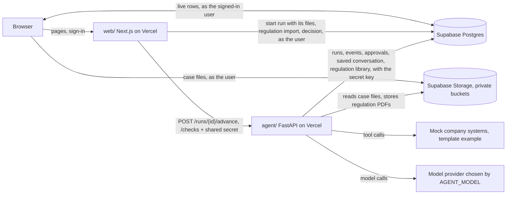

# Architecture

The decisions and their reasons are in `docs/adr/`. This page is the map. What the product must do
is in `docs/se/`; the data model for cases, regulations and requirements is ADR-0006.

**Where it stands on `main` (2026-10-24):** case upload, the regulation library import, Certivity's
checks and the sub-goal CLI exist. The agent that writes the requirements does not yet (#4): until
it lands, `domain/prompt.md` and the tools are still the template's example (engineering change
notices against mock PLM, CAD and ERP systems), and a run started with case files gets that
instruction.

## The pieces

- **web/** knows nothing about models or tools. It shows rows, uploads files to Storage as the
  signed-in user, and writes two things: a new run (with its files, `start_run()`) and a decision
  on an approval.
- **agent/** knows nothing about pages or users. It advances a run and writes down what happened.
- **supabase/** is the contract between them. A change to a table is a change to both sides.

## Who can do what

Every run, setting and key belongs to an **organisation** (a client). The roles are in the
database, checked by row-level security and by the functions that change things
(`supabase/migrations/20261014120000_platform.sql`):

- **Platform admin**: operates the deployment; manages every organisation and creates new ones.
  A row in `private.platform_admins`, which no API can write (`scripts/create-user.sh
  --platform-admin`, or setup for the first person).
- **Admin** of an organisation: its people, settings (model, limits) and provider keys.
- **Member**: starts runs and decides approvals.
- **Viewer**: reads runs; changes nothing.

Settings have their defaults in the agent's environment; an organisation's row stores only what
it changed. Provider keys live in Supabase Vault; the browser sees provider and last four
characters, only the agent reads a key back. Every change to settings, keys and people writes a
row to `audit_events`.

## A run, step by step

1. A person attaches the case files and an optional note. The browser uploads the files to the
   private `case-files` bucket under the organisation's folder; the web calls `start_run()` as
   that user, which inserts the `runs` row (`queued`) and one `run_files` row per file in one
   transaction, and calls the agent: "advance this run". The agent downloads and reads the files
   (`domain/ingest.py`) and records one `case_file` event per file before the model starts.
2. The agent claims the run (`queued` to `running`, in one conditional update so two requests
   cannot both get it) and starts the loop. Every model message and tool call becomes a
   `run_events` row as it happens. The browser shows them live.
3. The model calls a tool marked `requires_approval`. The library stops the run before the tool
   executes. The agent saves the conversation to `run_state`, inserts an `approvals` row, sets the
   run to `awaiting_approval`, and the request ends. Nothing is running now.
4. A person approves or denies in the web. The web records the decision as that user and calls
   "advance" again.
5. The agent loads the conversation, hands the decision to the library, and the loop continues:
   the tool runs if approved, or the model is told it was denied.
6. The run ends as `succeeded` with an output, or `failed` with an error.

## Where things live

| To change | Edit |
|---|---|
| What the agent is for: prompt, tools, mock systems | `agent/agent_service/domain/` |
| Which model runs it | `AGENT_MODEL` and the provider's key; no code |
| Certivity's validate and score (copied, never edited) | `scripts/sync-certivity.sh`, then `agent/certivity/` |
| Certivity's reference data (index, answer files) | `make certivity-load`, table `certivity_reference` |
| The loop, limits, what gets logged | `agent/agent_service/runner.py`, `settings.py` |
| Tables, who can read and write | `supabase/migrations/` and `supabase/tests/` |
| The regulation library and its import | `agent/agent_service/domain/regulations.py`, `web/app/(app)/regulations/`, `docs/regulations-store.md` |
| Regulation PDFs split into paragraphs with pages | `agent/agent_service/domain/paragraphs.py`, table `regulation_paragraphs` |
| Pages and the trace | `web/app/`, `web/lib/trace.ts` |
| What runs on a push | `.github/workflows/deploy.yml`, `Makefile` |

## How it fails

| What happens | What you see | Why it is handled this way |
|---|---|---|
| A tool raises, or the model loops | Run `failed`, with the error in the trace | A failure is a recorded state, not a crash |
| The run exceeds `RUN_TIMEOUT_S` (770 s; 30 s under Vercel Pro's 800 s) | Run `failed`: "Ran out of time" | It ends before the platform kills the function |
| The function dies mid-run | Run stays `running`; after 60 s without a heartbeat the next "advance" marks it `failed` | Nothing is re-run automatically: an approved write could execute twice |
| The agent is unreachable | Run stays `queued`; the page offers Send to agent | The run exists as a row whether or not the agent answered |
| The model provider is down | Run `failed`; set `AGENT_MODEL=scripted` to keep the demo alive | The scripted model needs no network |
| Two people click Approve and Deny | The first one wins; the second gets a conflict | The policy only lets a pending approval be decided |

## What this does not do

- **No queue and no background workers.** A run executes inside one HTTP request. A regulation
  import is cut into slices of one request each, and the next slice starts only while an import
  page is open in a browser. A step longer
  than the function limit (300 s on Vercel Hobby, 800 s on Pro) does not fit; the way out is the
  container in `agent/Dockerfile`.
- **No emails.** Admins create people with an initial password and share it themselves.
- **No subscription logins.** Keys are pasted, or obtained with OpenRouter's one-click login;
  "sign in with Claude/ChatGPT" is prohibited or partner-only for hosted apps (ADR-0004).
- **The approval is a pause, not a named sign-off.** Any admin or member of the organisation can
  approve. If a step needs a specific person's consent, the tool has to check who decided.
- **No streaming of the model's text token by token.** The trace updates per message and per tool
  call, which is what a reviewer needs.
- **No tracing product.** The `run_events` table is the trace. Logfire or another OpenTelemetry
  backend can be added in `agent_service/__init__.py` in a few lines.
- **The mock systems do not persist writes.** They exist to be replaced.
- **Case content is not stored yet.** Case files belong to a run (`run_files`), and the agent
  reads them again at the start of each run; the text and images it sends the model end up only
  in that run's saved conversation. ADR-0006 replaces this with organisation-owned cases whose
  ingested blocks are rows.
- **Uploads that never become a run stay in the bucket.** If an upload or `start_run()` fails,
  the files already uploaded are linked to no run, and only the agent's secret key can delete
  them. The purge empties the whole bucket (#16).
- **Certivity checks are not stored.** `POST /checks` on the agent runs Certivity's `validate.py`
  and, for a case with an `expected.json`, `score_local.py`, on text the web sends (a succeeded
  run's output, or a file pasted on the Checks page). They take milliseconds, so they are
  recomputed on each view. What they compare against (the regulation index, the answer files) is
  read from the table `certivity_reference`, which only the agent can read. The agent's own `certivity_check` tool gets
  validation without the score, so the model cannot tune to the one case that has an answer key.
