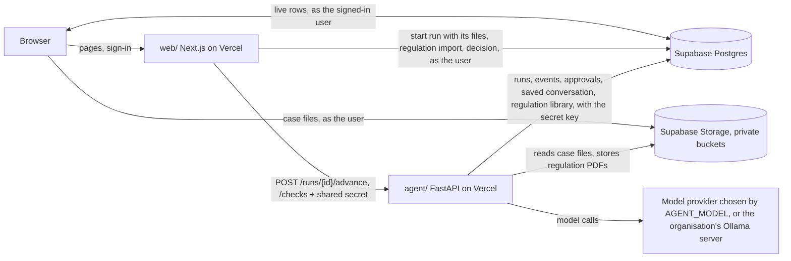

# Architecture

The decisions and their reasons are in `docs/adr/`. This page is the map. What the product must do
is in `docs/se/`; the data model for cases, regulations and requirements is ADR-0006.

**Where it stands on `main` (2026-10-24):** case upload, the regulation library import with
paragraphs, Certivity's checks, the sub-goal, and the requirement writer (#4) exist. The writer has
run only with the scripted model so far; its first timed run on the dev case with a real model is
#14.

## The pieces

- **web/** knows nothing about models or tools. It shows rows, uploads files to Storage as the
  signed-in user, and writes three things: projects, cases and their files; a new run on a case;
  and a decision on an approval. `start_run()` with files of the run's own still works for API
  callers; the page no longer uses it.
- **agent/** knows nothing about pages or users. It advances a run and writes down what happened.
- **supabase/** is the contract between them. A change to a table is a change to both sides.

## Who can do what

Every run, setting and key belongs to an **organisation** (a client). The roles are in the
database, checked by row-level security and by the functions that change things
(`supabase/migrations/20261014120000_platform.sql`):

- **Platform admin**: operates the deployment; manages every organisation and creates new ones.
  A row in `private.platform_admins`, which no API can write (`scripts/create-user.sh
  --platform-admin`, or setup for the first person).
- **Admin** of an organisation: its people, settings (model, limits) and provider keys.
- **Member**: starts runs and decides approvals.
- **Viewer**: reads runs; changes nothing.

Settings have their defaults in the agent's environment; an organisation's row stores only what
it changed. Provider keys live in Supabase Vault; the browser sees provider and last four
characters, only the agent reads a key back. Ollama is the exception to "one key": it is a server
the organisation runs, stored as a URL and an authentication scheme (none, bearer, basic) that
members can see, plus a token or password in Vault (`set_provider_endpoint`,
`read_provider_endpoint`). The agent calls that URL, so it must be reachable from where the agent
runs. Every change to settings, keys and people writes a
row to `audit_events`.

## A run, step by step

1. A person picks or creates a project and a case, adds files and an optional note. The browser
   uploads each file to the private `case-files` bucket under `{organisation}/{case}/` and inserts
   a `case_files` row as that user (RLS accepts it only for an object that exists in that folder).
   The web asks the agent to parse the case (`POST /cases/{id}/ingest`): parsers first, a small
   model (`INGEST_MODEL`) only for what they cannot read, the result stored once as
   `case_file_blocks` (`domain/case_ingest.py`). The page waits until every file is `parsed` or
   `failed`, then inserts the `runs` row (`queued`, with `case_id`) and calls the agent: "advance
   this run". The agent builds the first message from the stored blocks and records one
   `case_file` event per file before the model starts.
2. The agent claims the run (`queued` to `running`, in one conditional update so two requests
   cannot both get it) and starts the loop. Every model message and tool call becomes a
   `run_events` row as it happens. The browser shows them live.
3. On a case, the orchestrator (`domain/prompt.md`) reads the library's scope summaries and
   searches it (`domain/regulation_search.py`: by meaning where embeddings exist, by words
   otherwise), then has writers read each chosen regulation in windows of about 15 pages, in
   parallel. Each writer stores a `draft` row in `requirements` per obligation, citing one
   paragraph; code copies the citation from the paragraph row (`domain/writer.py`). A check agent
   reads each requirement next to its paragraph, and code lists the "shall" paragraphs nobody
   cited. The orchestrator rejects or fills in, then asks for the export: a tool marked
   `requires_approval` (`export_requirements`). The library stops the run before the tool
   executes. The agent saves the conversation to `run_state`, inserts an `approvals` row, sets the
   run to `awaiting_approval`, and the request ends. Nothing is running now.
4. A person approves or denies in the web. The web records the decision as that user and calls
   "advance" again.
5. The agent loads the conversation, hands the decision to the library, and the loop continues:
   the tool runs if approved, or the model is told it was denied.
6. The run ends as `succeeded` with an output, or `failed` with an error. For a requirement run
   the output is Certivity's submission file, built by code from the run's rows that were not
   rejected (approved, or still draft if the export was denied).

## Where things live

| To change | Edit |
|---|---|
| What the agent is for: prompts, tools, the writer and the check | `agent/agent_service/domain/` |
| A run's requirements and what they cite | table `requirements` (`20261024250000_requirements.sql`) |
| Which model runs it | `AGENT_MODEL` and the provider's key; no code |
| Certivity's validate and score (copied, never edited) | `scripts/sync-certivity.sh`, then `agent/certivity/` |
| Certivity's reference data (index, answer files) | Reloaded on every release; `make certivity-load` locally; table `certivity_reference` |
| The loop, limits, what gets logged | `agent/agent_service/runner.py`, `settings.py` |
| Tables, who can read and write | `supabase/migrations/` and `supabase/tests/` |
| The regulation library and its import | `agent/agent_service/domain/regulations.py`, `web/app/(app)/regulations/`, `docs/regulations-store.md` |
| Regulation PDFs split into paragraphs with pages | `agent/agent_service/domain/paragraphs.py`, table `regulation_paragraphs` |
| Pages and the trace | `web/app/`, `web/lib/trace.ts` |
| The assistant on every page of a project | `agent/agent_service/domain/assistant.py` and `assistant.md`, `domain/project_store.py`, `web/components/assistant.tsx` |
| What runs on a push | `.github/workflows/deploy.yml`, `Makefile` |

## How it fails

| What happens | What you see | Why it is handled this way |
|---|---|---|
| A tool raises, or the model loops | Run `failed`, with the error in the trace | A failure is a recorded state, not a crash |
| The run exceeds `RUN_TIMEOUT_S` (770 s; 30 s under Vercel Pro's 800 s) | Run `failed`: "Ran out of time" | It ends before the platform kills the function |
| The function dies mid-run | Run stays `running`; after 60 s without a heartbeat the next "advance" marks it `failed` | Nothing is re-run automatically: an approved write could execute twice |
| The agent is unreachable | Run stays `queued`; the page offers Send to agent | The run exists as a row whether or not the agent answered |
| The model provider is down | Run `failed`; set `AGENT_MODEL=scripted` to keep the demo alive | The scripted model needs no network |
| Two people click Approve and Deny | The first one wins; the second gets a conflict | The policy only lets a pending approval be decided |

## What this does not do

- **No queue and no background workers.** A run executes inside one HTTP request. A regulation
  import is cut into slices of one request each, and the next slice starts only while an import
  page is open in a browser. A step longer
  than the function limit (300 s on Vercel Hobby, 800 s on Pro) does not fit; the way out is the
  container in `agent/Dockerfile`.
- **No emails.** Admins create people with an initial password and share it themselves.
- **No subscription logins.** Keys are pasted, or obtained with OpenRouter's one-click login;
  "sign in with Claude/ChatGPT" is prohibited or partner-only for hosted apps (ADR-0004).
- **The approval is a pause, not a named sign-off.** Any admin or member of the organisation can
  approve. If a step needs a specific person's consent, the tool has to check who decided.
- **No streaming of the model's text token by token.** The trace updates per message and per tool
  call, which is what a reviewer needs.
- **No tracing product.** The `run_events` table is the trace. Logfire or another OpenTelemetry
  backend can be added in `agent_service/__init__.py` in a few lines.
- **The mock systems do not persist writes.** They exist to be replaced.
- **Usage is the agent's estimate, not the provider's bill.** Every model the agent builds is
  wrapped by `agent_service/metering.py`, and the two embedding calls report to it too. One
  `model_usage` row per model and key per piece of work (run segment, case ingest, index slice,
  chat answer) is what Admin, Usage shows and what the monthly cap sums (SYS-40, IF-7). Costs come
  from genai-prices; a model it does not know has no cost and the page says the total is a lower
  bound. Calls made outside the agent (the evals, a developer's own scripts) are not recorded.
- **A case's files are parsed once, not again per run.** A file added later is parsed when it is
  added; nothing re-parses a file that is already `parsed`. A file left `parsing` by a request
  that died stays so (the page stops waiting after 10 minutes and the run's trace says which
  file the agent did not have); uploading it again is the way out.
- **The saved conversation still carries the images.** Each run's `run_state` holds the base64 of
  the images it sent the model, so a case's drawings are stored once per run as well as once in
  the bucket.
- **Uploads that never become a row stay in the bucket.** If the `case_files` insert or
  `start_run()` fails after an upload, the object is linked to nothing, and only the agent's
  secret key can delete it. The purge empties the whole bucket (#16).
- **Questions to the assistant are not stored; only their cost is.** The bubble on every page
  of a project (SYS-39) sends the conversation the tab holds, with the page's path, to
  `POST /api/chat`, which checks that the person can read the project's organisation (viewers
  included) and calls the agent's `POST /chat`. The agent answers with the organisation's model
  and key, from the project's regulations, cases and runs, the run or case on the page, and
  read-only tools (library search within the project's regulations, a paragraph, a run, a case).
  It refuses when the organisation is over its monthly cap, and records what each answer cost in
  `model_usage` as process `chat`, through the same model wrapper as everything else (SYS-40,
  IF-7). The conversation lasts as long as the tab: it is not shared between tabs, devices or
  people.
- **Certivity checks are not stored.** `POST /checks` on the agent runs Certivity's `validate.py`
  and, for a case with an `expected.json`, `score_local.py`, on text the web sends (a succeeded
  run's output, or a file pasted on the Checks page). They take milliseconds, so they are
  recomputed on each view. What they compare against (the regulation index, the answer files) is
  read from the table `certivity_reference`, which only the agent can read. The agent's own `certivity_check` tool gets
  validation without the score, so the model cannot tune to the one case that has an answer key.
